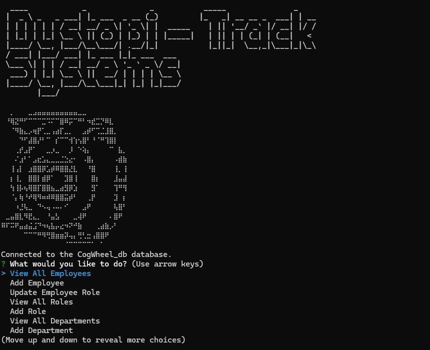
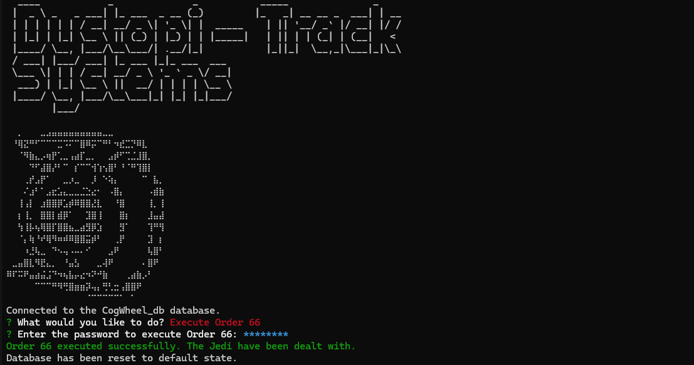

# Dystopi-Track Systems

A command-line employee-management application built as a University of Utah coding bootcamp project. It uses Node.js, PostgreSQL, and Inquirer to manage departments, roles, and employees. The dystopian-corporate presentation and optional "Order 66" demo reset are intentionally playful.

## What it demonstrates

- Relational data modeling with foreign keys and self-referencing employee/manager relationships
- Parameterized PostgreSQL queries for adding and updating records
- Interactive terminal prompts and simple data tables
- An optional reset that runs inside a database transaction

This is an educational CLI portfolio project, not a production HR platform.

## Setup

**Prerequisites:** Node.js and a local PostgreSQL server with a user permitted to create a database. The SQL bootstrap recreates `cogwheel_db` and **deletes existing data in that database**.

```bash
git clone https://github.com/AaronBringhurst/Dystopi-Track-software.git
cd Dystopi-Track-software
npm install
```

Configure PostgreSQL via standard environment variables; see [`.env.example`](.env.example) for the names and sample values. The application does **not** automatically load a `.env` file.

For example, in PowerShell (replace the password with your own local value):

```powershell
$env:PGHOST = "localhost"
$env:PGPORT = "5432"
$env:PGUSER = "postgres"
$env:PGPASSWORD = "YOUR_LOCAL_POSTGRES_PASSWORD"
$env:PGDATABASE = "cogwheel_db"
```

Then initialize the local database from the project root using the `psql` command-line tool:

```bash
psql -d postgres -f db/schema.sql
node index.js
```

The bootstrap script drops and recreates `cogwheel_db`, creates department/role/employee tables, and imports sample data. It should only be run against a disposable local PostgreSQL instance. If your PostgreSQL username cannot create databases, use an appropriately authorized local account for the bootstrap.

## Menu actions

- View employees, roles, and departments
- Add employees, roles, and departments
- Change an existing employee's role
- **Execute Order 66**: explicitly reset employee, role, and department records to the demonstration seed data
- Exit

The reset is destructive to application data and is intended only for local demonstrations. The legacy novelty password shown in the application is **not** a security boundary; database access must be protected separately.

## Screenshots and walkthrough





[Watch the original walkthrough](https://youtu.be/no6CVMSEkvY) · [Walkthrough video in repository](media/videos/homework12walkthrough.mp4)

## Structure

- [`index.js`](index.js) — interactive menu and startup
- [`services/queries.js`](services/queries.js) — PostgreSQL read/write operations
- [`services/pool.js`](services/pool.js) — environment-driven PostgreSQL connection pool
- [`services/utils.js`](services/utils.js) — transactional reset/demo feature
- [`db/schema.sql`](db/schema.sql) — database bootstrap
- [`db/seeds.sql`](db/seeds.sql) — fictional sample records

## Technologies

Node.js, JavaScript, PostgreSQL, [node-postgres](https://node-postgres.com/), Inquirer, Colors, Figlet, and cli-progress.

## Status

Educational portfolio project. Setup and code have been corrected for several issues discovered during a portfolio review; a full end-to-end run against PostgreSQL has not yet been independently verified.

## Contact

[GitHub](https://github.com/AaronBringhurst) · [Email](mailto:bringhurst.aaron@gmail.com)
